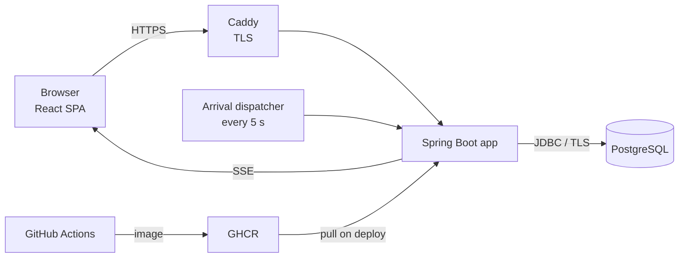
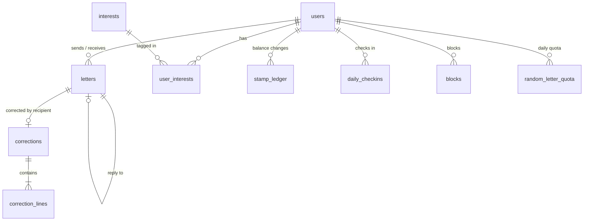

<p align="center">
  
</p>

<h4 align="center">
  아날로그 편지처럼 거리에 비례해 천천히 날아가는 온라인 편지,<br>
  그리고 원어민이 문장을 고쳐주며 언어를 배우는 펜팔 앱
</h4>

<p align="center">
  <a href="https://kren.jennachoi.me"><b>Live demo</b></a><br>
  가입 없이 로그인 화면의 <b>TRY A DEMO</b> 버튼으로 바로 둘러볼 수 있습니다.
</p>

<p align="center">
  <a href="https://github.com/jennachoi/KREN_V2/actions/workflows/ci.yml"></a>
</p>

<p align="center">
  
</p>

<br>

## 목차

- [배경](#배경)
- [개요](#개요)
- [기능](#기능)
- [기술 스택](#기술-스택)
- [동작 방식](#동작-방식)
- [기술적 과제](#기술적-과제)
- [설계 결정](#설계-결정)
- [배운 점](#배운-점)
- [앞으로 할 것](#앞으로-할-것)
- [실행 방법](#실행-방법)
- [출처](#출처)
<br>

## 배경

KREN은 2021년 코딩 부트캠프에서 6명이 만든 최종 프로젝트입니다. Java, Spring 5, JSP, MyBatis, Oracle로 만들었고, 저는 백엔드 초기 설계에 참여했으며 회원가입, 프로필, 계정 설정, 다국어 지원, UI 연동을 맡았습니다.

KREN v2는 2026년에 이 프로젝트를 혼자 처음부터 다시 만든 버전입니다. 원래 버전도 완성도가 있었지만, 서버에서 JSP로 화면을 그리는 구조와 MyBatis, Oracle 조합은 지금 새 서비스를 시작할 때 고르는 스택과 거리가 멉니다. 그래서 같은 도메인을 현재 스택으로 옮기고, 범위를 줄인 대신 남긴 기능은 더 깊게 만들었습니다. 옛 코드는 하나도 가져오지 않았고, 도메인 규칙과 화면 디자인만 참고했습니다.

| | 2021 KREN | 2026 KREN v2 |
|---|---|---|
| 서버 | Spring 5, JSP 서버 렌더링 | Spring Boot 4.1 (Java 25) REST API |
| 화면 | JSP | React 19 + TypeScript SPA, 같은 주소에서 서빙 |
| 데이터 접근 | MyBatis | Spring Data JPA, 동시성이 걸린 곳은 직접 쓴 SQL |
| 데이터베이스 | Oracle | PostgreSQL 18, Flyway 마이그레이션 |

v2에는 여기에 Server-Sent Events 실시간 알림, Testcontainers 통합 테스트, GitHub Actions CI/CD, Docker 이미지, Azure 배포를 더했습니다.

백엔드 초기 설계에 참여했던 덕분에 도메인 규칙은 이미 알고 있었습니다. 그래서 이번에는 기능 수보다 백엔드가 정확하게 동작하는지에 시간을 썼습니다. 지켜야 하는 규칙은 데이터베이스 제약으로 걸고, 동시 요청이 몰리는 경우는 실패하는 테스트로 먼저 재현한 다음 고쳤습니다.
<br>

## 개요

언어교환 앱은 대체로 두 종류입니다. 펜팔 사이트는 여러 나라 사람을 이어주지만 공부에는 별 도움이 안 되고, 채팅 앱은 교정 기능이 있어도 짧고 빠른 메시지 위주가 됩니다. KREN은 그 사이를 노렸습니다. 바로바로 오가는 짧은 메시지 대신, 상대가 시간을 들여 정성껏 쓴 편지를 기다렸다가 받는 기쁨을 느꼈으면 했습니다.

내가 배우는 언어가 모국어이고 내 언어를 배우는 사람에게 편지를 씁니다. 편지는 지도 위를 날아가서 거리만큼 시간이 걸려 도착합니다. 같은 나라 안이면 두 시간, 서울에서 워싱턴 D.C.까지는 46시간쯤 걸립니다. 도착하면 받은 사람이 답장을 쓰고 내 문장을 하나씩 고쳐줄 수 있습니다. 남의 편지를 고쳐주면 우표를 하나 받고, 편지를 보낼 때 하나를 씁니다. 그래서 받기만 하는 사람도 결국은 누군가의 편지를 고쳐줘야 합니다. 내가 받은 교정은 노트에 모입니다.

데모 사이트에서는 데모 계정끼리 몇 분마다 편지를 쓰고, 고치고, 답장하는 백그라운드 작업이 돕니다. 실제 서비스 코드를 그대로 거치기 때문에 언제 들어가도 날아가는 편지와 새 교정이 있습니다. 기다리는 시간을 줄이려고 데모 사이트에서는 비행 시간 1시간이 1분으로 흐릅니다.

백엔드는 Java 25와 Spring Boot 4, PostgreSQL이고, 프론트엔드는 React와 TypeScript로 만든 SPA를 같은 주소에서 서빙합니다. 화면은 2021년 KREN 디자인을 다시 만든 것입니다.
<br>

## 기능

### 가입과 프로필

5단계 가입에서 계정 정보, 나라, 언어 짝과 관심사, 짧은 자기소개를 받습니다. 프로필에는 언어 짝, 관심사(보는 사람과 겹치는 것은 강조 표시), 가입일, 우표 내역이 나오고, 아바타는 일러스트 중에서 고릅니다.

### 홈 대시보드

로그인하면 가장 먼저 보이는 화면입니다. 지금 오가는 편지와 할 일을 한 화면에 모았습니다.

<p align="center"><br><sub>지도 위로 편지가 날아가는 모습 (타임랩스)</sub></p>

- 가운데 지도에는 날아가는 중인 편지가 비행기로 표시됩니다. 나에게 오는 편지는 빨간색, 내가 보낸 편지는 파란색입니다.
- 지도 아래 숫자는 곧 도착할 편지, 날아가는 중인 내 편지, 답장을 기다리는 편지 수입니다. 그 밑으로 각 편지의 진행률과 남은 시간, 답장할 편지 목록이 이어집니다.
- 왼쪽에서는 매일 출석으로 우표를 받고, 남은 우표 수와 내역을 봅니다.
- 오른쪽에는 관심사가 많이 겹치는 순서로 추천 펜팔 다섯 명이 나옵니다. 그 아래 랜덤 편지 카드를 누르면 언어가 맞는 새로운 사람에게 편지를 보낼 수 있고, 하루에 새로운 사람 세 명까지 가능합니다.

### 펜팔 찾기

내가 배우는 언어가 모국어이면서 내 언어를 배우는 사람을 관심사로 거르고 페이지 단위로 보여줍니다. 어느 한쪽이라도 차단했으면 목록에서 빠집니다.

<p align="center"><br><sub>한국어 원어민이면서 영어를 배우는 사람 중 여행이나 음식에 관심 있는 사람</sub></p>

### 느린 배달과 실시간 추적

배달 시간은 거리에 비례합니다. 처리 시간 2시간에 250km마다 1시간이 더해지고, 최대 72시간입니다. 편지가 날아가는 동안 받는 사람은 경로, 진행률, 남은 시간을 볼 수 있지만 본문은 볼 수 없습니다.

<p align="center"><br><sub>도착 전까지 봉인된 편지. 비행기가 항로를 따라 움직입니다. (타임랩스)</sub></p>

### 편지와 교정

편지함은 펜팔별 대화 목록입니다. 한 사람을 고르면 둘 사이 편지가 오래된 순서로 이어지고, 지난 편지는 접혀 있습니다. 답장을 누르면 왼쪽에 상대 편지를 문장별로 고치는 칸이, 오른쪽에 내 엽서가 열립니다. 폰에서는 탭으로 나뉩니다.

교정은 바뀐 문장만 저장되고, 문장마다 메모를 붙일 수 있습니다. 보낸 사람은 원래 문장과 고친 문장을 위아래로 보는데, 지워진 부분은 빨강, 추가된 부분은 파랑입니다. 영어는 단어 단위로, 한글은 글자 단위로 비교해서 "famous for"를 "popular with"로 바꿔도 글자가 뒤섞여 보이지 않습니다. 받은 교정은 전부 노트에도 쌓입니다.

<p align="center"><br><sub>받은 교정을 펼치면 BEFORE와 AFTER가 바뀐 부분만 색으로 표시됩니다.</sub></p>

### 우표, 알림, 차단

우표는 가입 보너스, 매일 출석, 교정으로 생기고, 모든 변동이 내역에 남습니다. 편지가 출발하거나 도착할 때, 새 교정이 달릴 때 브라우저로 바로 알림이 옵니다. 차단하면 서로 검색과 프로필에서 사라지고 새 편지를 보낼 수 없습니다. 이미 주고받은 편지는 양쪽 편지함에 남습니다.

### 모바일

폰에서는 하단 탭바와 작은 헤더로 바뀌고, 엽서는 내용에 맞춰 늘어나는 카드가 됩니다.

<table align="center">
  <tr>
    <td align="center" width="50%"><br><sub>홈 대시보드</sub></td>
    <td align="center" width="50%"><br><sub>펜팔과의 편지 스레드</sub></td>
  </tr>
</table>

<br>

## 기술 스택

| 영역 | 기술 |
|---|---|
| 백엔드 | Java 25, Spring Boot 4.1, Spring Security, Spring Data JPA (Hibernate 7), Bean Validation |
| 데이터베이스 | PostgreSQL 18, Flyway |
| 실시간 알림 | Server-Sent Events |
| 프론트엔드 | React 19, TypeScript, Vite, Tailwind CSS 4, TanStack Query, React Router |
| 지도 | d3-geo, world-atlas (Natural Earth) |
| 테스트 | JUnit 5, Spring MockMvc, Testcontainers |
| 빌드와 CI | Maven, npm, GitHub Actions |
| 배포 | Azure VM, Azure Database for PostgreSQL, Docker, GitHub Container Registry, Caddy |

<br>

## 동작 방식

### 전체 구조



프론트엔드를 따로 배포하지 않고 Spring Boot 서버가 같이 서빙하도록 했습니다. 주소가 하나라서 로그인은 세션 쿠키로 처리하면 되고, 다른 도메인 사이의 요청(CORS)을 신경 쓸 필요가 없었습니다. 서버 앞에는 Caddy를 두어 HTTPS 인증서를 자동으로 받습니다. main 브랜치에 푸시하면 GitHub Actions가 테스트를 돌리고, Docker 이미지를 만들어 서버에 배포합니다.

백엔드 코드는 기능별로 패키지를 나눴습니다(`auth`, `user`, `letter`, `correction`, `stamp`, `block`, `notification`). 에러는 어디서 나든 같은 JSON 형식으로 내려가게 맞춰서, 프론트엔드가 에러를 한 가지 방식으로만 처리하면 됩니다.

### 데이터베이스



꼭 지켜야 하는 규칙은 코드보다 데이터베이스 제약으로 걸었습니다. 우표 잔액은 음수가 될 수 없고, 출석은 하루에 한 번, 자기 자신에게는 편지를 못 쓰고, 편지 하나에 교정은 하나만 달 수 있습니다. 코드에 실수가 있어도 데이터베이스가 한 번 더 막아줍니다. 테이블 변경은 Flyway 마이그레이션 파일(V1~V8)로만 합니다.

### 편지 한 통이 오가는 과정

1. 보내기: 우표 차감, 편지 저장, 우표 내역 기록을 트랜잭션 하나로 묶었습니다. 셋 중 하나라도 실패하면 전부 취소됩니다.
2. 비행 중: 받는 사람에게 편지가 오고 있다는 알림이 갑니다. 도착 시간 전에는 서버가 본문을 아예 내려주지 않아서, 화면을 조작해도 미리 읽을 수 없습니다.
3. 도착: 서버가 5초마다 도착 시간이 된 편지를 찾아서 받는 사람에게 알림을 보냅니다.
4. 교정: 받은 사람이 교정을 저장하면 우표 보상까지 한 번에 처리되고, 보낸 사람에게 알림이 갑니다.

시간에 따라 달라지는 코드는 현재 시간을 직접 읽지 않고 주입받은 `Clock`을 씁니다. 덕분에 테스트에서 시간을 도착 1분 전, 도착 순간으로 옮겨가며 확인할 수 있습니다.

편지함은 펜팔별로 묶어서 보여주는데, 목록을 만들 때 펜팔마다 쿼리를 따로 날리지 않고 한 번에 모아 옵니다. 스레드에서 이전 편지를 더 불러올 때는 마지막으로 본 편지를 기준으로 이어서 가져옵니다(keyset 페이지네이션). 그래서 그 사이에 새 편지가 와도 목록이 밀리지 않습니다.

<br>

## 기술적 과제

### 같은 요청이 동시에 몰릴 때

같은 요청이 동시에 여러 번 들어오면 "먼저 확인하고 나서 처리하는" 코드는 쉽게 깨집니다. 예를 들어 우표가 남았는지 확인한 뒤 차감하면, 두 요청이 동시에 "1장 남음"을 보고 둘 다 편지를 보낼 수 있습니다. 이런 곳을 네 군데 찾았고, 각각 병렬 요청을 보내는 테스트를 먼저 만들었습니다. 그다음 일부러 순진한 코드로 바꿔서 테스트가 정말 문제를 잡아내는지도 확인했습니다.

| 상황 | 해결 방법 | 순진한 코드일 때 | 고친 뒤 |
|---|---|---|---|
| 우표 3장으로 편지 10통을 동시에 보냄 | 잔액이 1 이상일 때만 차감하는 조건부 `UPDATE` | 10통 발송 | 정확히 3통 |
| 도착 처리 작업 여러 개가 같은 편지를 집어감 | `SELECT ... FOR UPDATE SKIP LOCKED`로 이미 누가 잡은 편지는 건너뜀 | 450통을 1,250번 처리 | 정확히 450통 |
| 같은 편지에 교정을 여러 번 동시에 저장 | 교정 테이블의 `UNIQUE(letter_id)` 제약 | (제약 조건이 막음) | 6번 중 1번만 성공, 우표도 1장만 지급 |
| 랜덤 편지 하루 3번 제한을 동시에 넘김 | 횟수 확인과 증가를 `INSERT ... ON CONFLICT` 한 문장으로 처리 | 6통 발송 | 정확히 3통 |

네 경우 모두 결국 판단을 데이터베이스가 한 번에 하게 만드는 것이 답이었습니다. 코드에서의 확인은 빨리 에러를 돌려주는 용도로만 남겼습니다.

### 기억에 남는 버그

- 테스트가 실행 순서에 따라 통과했다 실패했다 했습니다. 원인은 spring-security-test의 `csrf()` 헬퍼였는데, 한 번 쓰면 이후 테스트 전체의 CSRF 설정을 바꿔버렸습니다. 지금은 테스트가 실제 브라우저처럼 쿠키와 헤더를 보내서, 운영 설정도 같이 검증됩니다.
- 테스트는 다 통과했는데 직접 써보니 로그인 직후 첫 요청이 403으로 막혔습니다. Spring Security가 로그인할 때 CSRF 토큰을 새로 바꾸는데, 새 토큰이 한 박자 늦게 내려갔기 때문입니다. 지금은 로그인 응답에 바로 실어 보냅니다.
- `@Transactional`을 붙였는데 트랜잭션이 안 열렸습니다. 같은 클래스 안에서 메서드를 호출하면 Spring 프록시를 거치지 않기 때문이었고, `TransactionTemplate`으로 바꿔서 해결했습니다.
- 우표 업데이트 후 엔티티를 읽다가 `LazyInitializationException`이 났습니다. 업데이트 쿼리의 `clearAutomatically = true` 옵션이 엔티티를 영속성 컨텍스트에서 떼어냈기 때문입니다. 응답을 업데이트 전에 만들도록 순서를 바꿨습니다.
- 데모 데이터 생성이 중간에 실패해서 계정 하나만 남았는데, 그 뒤로는 "이미 데이터가 있다"며 매번 생성을 건너뛰었습니다. 지금은 전체를 트랜잭션 하나로 묶었습니다.
- 데이터베이스가 내려갔는데 로그인 화면에는 "비밀번호가 틀렸습니다"가 나왔습니다. Spring Security가 DB 오류도 인증 예외로 감싸는데, 에러 핸들러가 인증 예외를 전부 비밀번호 오류로 처리하고 있었습니다. 이 경우를 따로 잡아서 500을 돌려주게 고쳤습니다.

<br>

## 설계 결정

- 로그인은 JWT 대신 세션으로 했습니다. 프론트엔드와 API가 같은 주소라 쿠키를 그대로 쓸 수 있고, 로그아웃과 만료 처리도 더 간단합니다.
- 테스트는 H2 같은 가짜 DB 대신 Testcontainers로 실제 PostgreSQL을 띄워서 돌립니다. 제약 조건과 락처럼 PostgreSQL에서만 동작하는 부분을 제대로 확인하려면 진짜 DB가 필요했습니다.
- 차단 관계인 사람의 프로필을 열면 403이 아니라 404가 나옵니다. 403이면 "계정은 있다"는 게 드러나기 때문입니다. 남의 편지를 열려고 하면 403입니다.
- 알림은 트랜잭션이 커밋된 뒤에만 보냅니다. 발송이 취소됐는데 알림만 가는 일이 없고, 알림 전송이 실패해도 이미 끝난 발송에는 영향이 없습니다.
- 보내면 우표 -1, 교정하면 +1이라서 두 계정이 서로 주고받으며 우표를 불릴 수 없습니다.
- 실시간 알림(SSE) 연결은 서버 메모리에 있어서 서버가 한 대일 때만 동작합니다. 여러 대로 늘리면 Redis나 PostgreSQL `LISTEN/NOTIFY`로 이벤트를 나눠 보내야 합니다.

<br>

## 배운 점

배운 것 대부분은 위의 버그에서 나왔습니다. 테스트 도구가 내가 확인한다고 생각한 설정을 몰래 우회할 수 있다는 것, 그리고 테스트가 전부 통과해도 아무도 테스트하지 않은 흐름은 모른다는 것을 알게 됐습니다. 그래서 지금은 인증 쪽을 건드리면 꼭 앱을 직접 실행해봅니다. Spring 프록시나 Hibernate 영속성 컨텍스트도 책으로 읽을 때는 추상적이었는데, 각각 한 번씩 버그를 겪고 나서야 제대로 이해했습니다. 동시성 수정도 일부러 되돌려서 테스트가 실패하는 걸 봐야 테스트를 믿을 수 있었습니다.

프론트엔드에서는 2021년 디자인을 다시 만들면서 색, 간격, 컴포넌트 패턴을 디자인 토큰으로 정리했고, 배달 지도를 그리면서 지도 투영법과 두 지점 사이의 최단 항로를 계산하는 방법을 공부했습니다.
<br>

## 앞으로 할 것

- 원래 KREN처럼 프로필 사진 업로드와 자르기
- 신고와 관리자 화면
- 서버 여러 대에서도 실시간 알림이 가도록 Redis 또는 PostgreSQL `LISTEN/NOTIFY` 적용
<br>

## 실행 방법

JDK 25, Node 24, Docker가 필요합니다.

```bash
# 백엔드 (compose.yaml의 PostgreSQL을 자동으로 띄움)
cd backend
./mvnw spring-boot:run -Dspring-boot.run.arguments="--kren.demo.seed=true --kren.delivery.time-scale=60"

# 프론트엔드 개발 서버, :5173에서 핫 리로드 (/api는 :8080으로 프록시)
cd frontend
npm install
npm run dev
```

`kren.demo.seed`는 데모 계정 26개(비밀번호 `demo1234`)와 이미 날아가는 중인 편지를 만들고, `kren.delivery.time-scale=60`은 비행 시간 1시간을 1분으로 줄입니다.

```bash
cd backend && ./mvnw verify    # 일회용 PostgreSQL 컨테이너에서 테스트 112개 실행
cd frontend && npm run build   # SPA를 백엔드 static 리소스로 빌드
docker build -t kren .         # 운영 이미지
```

배포 방법은 [deploy/README.md](deploy/README.md)에 있습니다.
<br>

## 출처

- 프로필 그림: Pablo Stanley의 [Avataaars](https://avataaars.com/) (개인·상업적 이용 무료), [DiceBear](https://www.dicebear.com/)로 렌더링
- 세계 지도: [Natural Earth](https://www.naturalearthdata.com/), [world-atlas](https://github.com/topojson/world-atlas) 경유
- 화면 디자인은 2021년 KREN 원본 화면을 따랐고, 일부 일러스트는 그 프로젝트에서 쓴 UI 킷에서 가져왔습니다.
