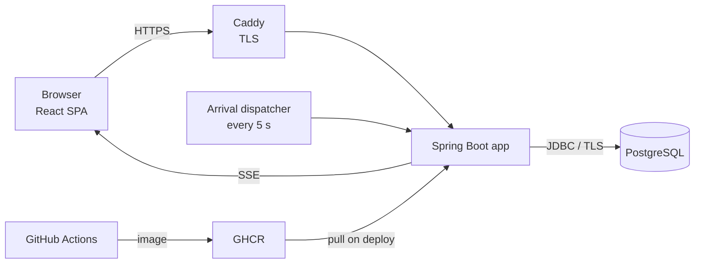
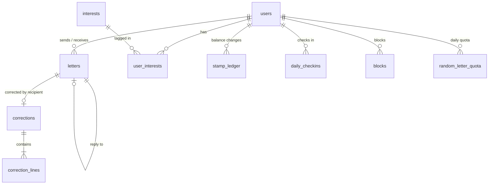

<h1 align="center">KREN</h1>

<h4 align="center">
  편지가 거리만큼 시간을 들여 날아가고, 받은 원어민이 문장을 고쳐주는 언어교환 펜팔 앱
</h4>

<p align="center">
  
</p>

<p align="center">
  <a href="https://kren.canadacentral.cloudapp.azure.com"><b>Live demo</b></a><br>
  로그인 화면의 <b>TRY A DEMO</b>를 누르면 데모 계정으로 바로 들어갑니다.<br>
  직접 로그인하려면 <code>minji@demo.kren</code> 또는 <code>emma@demo.kren</code>, 비밀번호 <code>demo1234</code><br>
  <sub>데모 사이트에서는 비행 시간 1시간이 1분으로 흐릅니다.</sub>
</p>

<p align="center">
  <a href="https://github.com/jennachoi/KREN_V2/actions/workflows/ci.yml"></a>
</p>

<p align="center">
  <br>
  <sub>홈 대시보드. 날아가는 중인 편지가 한 지도에 모입니다. (타임랩스)</sub>
</p>

<br>

## 목차

- [배경](#배경)
- [개요](#개요)
- [기능](#기능)
- [기술 스택](#기술-스택)
- [동작 방식](#동작-방식)
- [기술적 과제](#기술적-과제)
- [설계 결정](#설계-결정)
- [배운 점](#배운-점)
- [앞으로 할 것](#앞으로-할-것)
- [실행 방법](#실행-방법)
- [출처](#출처)
<br>

## 배경

KREN은 2021년 코딩 부트캠프에서 6명이 만든 최종 프로젝트입니다. Java, Spring 5, JSP, MyBatis, Oracle로 만들었고, 저는 백엔드 초기 설계에 참여했으며 회원가입, 프로필, 계정 설정, 다국어 지원, UI 연동을 맡았습니다.

KREN v2는 2026년에 이 프로젝트를 혼자 처음부터 다시 만든 버전입니다. 원래 버전도 완성도가 있었지만, 서버에서 JSP로 화면을 그리는 구조와 MyBatis, Oracle 조합은 지금 새 서비스를 시작할 때 고르는 스택과 거리가 멉니다. 그래서 같은 도메인을 현재 스택으로 옮기고, 범위를 줄인 대신 남긴 기능은 더 깊게 만들었습니다. 옛 코드는 하나도 가져오지 않았고, 도메인 규칙과 화면 디자인만 참고했습니다.

| | 2021 KREN | 2026 KREN v2 |
|---|---|---|
| 서버 | Spring 5, JSP 서버 렌더링 | Spring Boot 4.1 (Java 25) REST API |
| 화면 | JSP | React 19 + TypeScript SPA, 같은 주소에서 서빙 |
| 데이터 접근 | MyBatis | Spring Data JPA, 동시성이 걸린 곳은 직접 쓴 SQL |
| 데이터베이스 | Oracle | PostgreSQL 18, Flyway 마이그레이션 |

v2에는 여기에 Server-Sent Events 실시간 알림, Testcontainers 통합 테스트, GitHub Actions CI/CD, Docker 이미지, Azure 배포를 더했습니다.

백엔드 초기 설계에 참여했던 덕분에 도메인 규칙은 이미 알고 있었습니다. 그래서 이번에는 기능 수보다 백엔드가 정확하게 동작하는지에 시간을 썼습니다. 지켜야 하는 규칙은 데이터베이스 제약으로 걸고, 동시 요청이 몰리는 경우는 실패하는 테스트로 먼저 재현한 다음 고쳤습니다.
<br>

## 개요

언어교환 앱은 대체로 두 종류입니다. 펜팔 사이트는 여러 나라 사람을 이어주지만 공부에는 별 도움이 안 되고, 채팅 앱은 교정 기능이 있어도 짧고 빠른 메시지 위주가 됩니다. KREN은 그 중간을 노렸습니다.

내가 배우는 언어가 모국어이고 내 언어를 배우는 사람에게 편지를 씁니다. 편지는 지도 위를 날아가서 거리만큼 시간이 걸려 도착합니다. 같은 나라 안이면 두 시간, 서울에서 워싱턴 D.C.까지는 46시간쯤 걸립니다. 도착하면 받은 사람이 답장을 쓰고 내 문장을 하나씩 고쳐줄 수 있습니다. 남의 편지를 고쳐주면 우표를 하나 받고, 편지를 보낼 때 하나를 씁니다. 그래서 받기만 하는 사람도 결국은 누군가의 편지를 고쳐줘야 합니다. 내가 받은 교정은 노트에 모입니다.

데모 사이트에서는 데모 계정끼리 몇 분마다 편지를 쓰고, 고치고, 답장하는 백그라운드 작업이 돕니다. 실제 서비스 코드를 그대로 거치기 때문에 언제 들어가도 날아가는 편지와 새 교정이 있습니다.

백엔드는 Java 25와 Spring Boot 4, PostgreSQL이고, 프론트엔드는 React와 TypeScript로 만든 SPA를 같은 주소에서 서빙합니다. 화면은 2021년 KREN 디자인을 다시 만든 것입니다.
<br>

## 기능

### 가입과 프로필

5단계 가입에서 계정 정보, 나라, 언어 짝과 관심사, 짧은 자기소개를 받습니다. 프로필에는 언어 짝, 관심사(보는 사람과 겹치는 것은 강조 표시), 가입일, 우표 내역이 나오고, 아바타는 일러스트 중에서 고릅니다.

### 펜팔 찾기

내가 배우는 언어가 모국어이면서 내 언어를 배우는 사람을 관심사로 거르고 페이지 단위로 보여줍니다. 어느 한쪽이라도 차단했으면 목록에서 빠집니다. 랜덤 편지를 고르면 언어가 맞는 새로운 사람에게 보내는데, 하루에 새로운 사람 세 명까지입니다.

<p align="center"><br><sub>한국어 원어민이면서 영어를 배우는 사람 중 여행이나 음식에 관심 있는 사람</sub></p>

### 느린 배달과 실시간 추적

배달 시간은 거리에 비례합니다. 처리 시간 2시간에 250km마다 1시간이 더해지고, 최대 72시간입니다. 편지가 날아가는 동안 받는 사람은 경로, 진행률, 남은 시간을 볼 수 있지만 본문은 볼 수 없습니다. 홈 대시보드에는 날고 있는 편지가 전부 한 지도에 나오고, 곧 도착할 편지와 아직 답장하지 않은 편지가 옆에 정리됩니다.

<p align="center"><br><sub>도착 전까지 봉인된 편지. 비행기가 대권 항로를 따라 움직입니다. (타임랩스)</sub></p>

### 편지와 교정

편지함은 펜팔별 대화 목록입니다. 한 사람을 고르면 둘 사이 편지가 오래된 순서로 이어지고, 지난 편지는 접혀 있습니다. 답장을 누르면 왼쪽에 상대 편지를 문장별로 고치는 칸이, 오른쪽에 내 엽서가 열립니다. 폰에서는 탭으로 나뉩니다.

교정은 바뀐 문장만 저장되고, 문장마다 메모를 붙일 수 있습니다. 보낸 사람은 원래 문장과 고친 문장을 위아래로 보는데, 지워진 부분은 빨강, 추가된 부분은 파랑입니다. 영어는 단어 단위로, 한글은 글자 단위로 비교해서 "famous for"를 "popular with"로 바꿔도 글자가 뒤섞여 보이지 않습니다. 받은 교정은 전부 노트에도 쌓입니다.

<p align="center"><br><sub>받은 교정을 펼치면 BEFORE와 AFTER가 바뀐 부분만 색으로 표시됩니다.</sub></p>

### 우표, 알림, 차단

우표는 가입 보너스, 매일 출석, 교정으로 생기고, 모든 변동이 내역에 남습니다. 이륙, 도착, 새 교정은 Server-Sent Events로 브라우저에 바로 옵니다. 차단하면 서로 검색과 프로필에서 사라지고 새 편지를 보낼 수 없습니다. 이미 주고받은 편지는 양쪽 편지함에 남습니다.

### 모바일

폰에서는 하단 탭바와 작은 헤더로 바뀌고, 엽서는 내용에 맞춰 늘어나는 카드가 됩니다.

<table align="center">
  <tr>
    <td align="center" width="50%"><br><sub>홈 대시보드</sub></td>
    <td align="center" width="50%"><br><sub>펜팔과의 편지 스레드</sub></td>
  </tr>
</table>

<br>

## 기술 스택

| 영역 | 기술 |
|---|---|
| 백엔드 | Java 25, Spring Boot 4.1, Spring Security, Spring Data JPA (Hibernate 7), Bean Validation |
| 데이터베이스 | PostgreSQL 18, Flyway 마이그레이션 |
| 실시간 | Server-Sent Events, 트랜잭션 애플리케이션 이벤트 |
| 프론트엔드 | React 19, TypeScript, Vite, Tailwind CSS 4, TanStack Query, React Router |
| 지도 | d3-geo, world-atlas (Natural Earth) |
| 테스트 | JUnit 5, Spring MockMvc, Testcontainers (실제 PostgreSQL) |
| 빌드와 CI | Maven, npm, GitHub Actions |
| 배포 | Azure VM (Arm64), Azure Database for PostgreSQL, Docker (멀티 스테이지 이미지), GitHub Container Registry, Docker Compose, Caddy (HTTPS 자동 발급) |

<br>

## 동작 방식

### 아키텍처



React 빌드 결과는 Spring Boot jar에 같이 들어가서 API와 같은 주소에서 서빙됩니다. 덕분에 인증이 단순합니다. 세션 쿠키와 double-submit CSRF 쿠키만 쓰고, CORS 설정은 없습니다. 화면 경로는 `index.html`로 돌려보내고, 없는 `/api` 경로는 그대로 JSON 에러를 돌려줍니다.

백엔드는 도메인별 패키지(`auth`, `user`, `letter`, `correction`, `stamp`, `block`, `notification`)로 나뉘고, 각 패키지에 controller, service, repository, DTO가 있습니다. 모든 에러는 RFC 9457 problem detail 형식에 기계가 읽을 수 있는 `code`를 달고 나갑니다. Security 필터 체인 안에서 나는 401, 403도 같은 형식입니다.

### 데이터 모델



항상 지켜져야 하는 규칙은 데이터베이스에 있습니다. 우표 잔액은 음수가 될 수 없고, 출석은 사용자와 날짜마다 하나이며, 자기 자신에게는 편지를 쓸 수 없고, 편지 하나에 교정은 최대 하나, 고친 문장은 원래 문장과 달라야 합니다. 스키마는 Flyway가 관리하고(V1~V8), Hibernate는 검증만 합니다.

### 편지 한 통의 일생

1. 발송은 트랜잭션 하나로 처리됩니다. 우표를 차감하고, 출발지, 도착지, 거리, `deliver_at`과 함께 편지를 저장하고, 우표 내역을 남깁니다.
2. 커밋이 끝나면 받는 사람에게 `incoming` 이벤트가 갑니다. `deliver_at` 전까지 API는 받는 사람에게 경로와 도착 시간만 주고 본문과 미리보기는 숨기며, 답장과 교정도 거절합니다.
3. 디스패처가 5초마다 깨어나 도착한 편지를 가져가고, 받는 사람마다 `letter` 이벤트를 보냅니다.
4. 받은 사람이 편지를 교정합니다. 교정 저장과 우표 보상은 한 트랜잭션이고, 보낸 사람에게 `correction` 이벤트가 갑니다.

시간에 따라 달라지는 로직은 전부 주입된 `Clock`을 읽습니다. 그래서 테스트에서 편지가 도착하기 1분 전과 도착한 순간으로 시간을 옮길 수 있습니다.

### 편지함 조회

대화 목록은 펜팔별로 묶는 쿼리 한 번으로 최신 편지, 안 읽은 편지 수, 답장 대기 수, 비행 중인 편지 수를 가져옵니다. 대화 스레드는 keyset 커서로 과거 방향 페이지를 넘기고, 이를 위해 두 사람 쌍 인덱스를 추가했습니다(V8).

### 데모 트래픽

운영 환경에서는 `DemoTraffic`이 몇 분마다 데모 계정끼리 편지를 쓰고, 읽고, 교정하고, 답장하게 합니다. 실제 서비스 메서드를 호출하므로 우표 차감과 알림도 실제와 똑같이 일어납니다. 생성된 편지는 일주일 뒤 지웁니다.

<br>

## 기술적 과제

### 동시성 문제 4개, 각각 실패하는 테스트로 확인

각 문제마다 병렬 요청을 보내는 테스트를 먼저 쓰고, 흔히 쓰는 "확인하고 나서 처리하는" 구현으로 바꿔서 테스트가 실제로 잡아내는지 확인했습니다.

| 문제 | 해결 | 순진한 구현 | 실제 결과 |
|---|---|---|---|
| 우표 3장으로 10통 동시 발송 | 발송 트랜잭션 안에서 조건부 `UPDATE ... SET balance = balance - 1 WHERE balance >= 1` | 10통 발송됨 | 정확히 3통 |
| 여러 디스패처가 같은 편지를 도착 처리 | `SELECT ... FOR UPDATE SKIP LOCKED`로 워커마다 겹치지 않는 묶음을 가져감 | 450통을 1,250번 처리 | 정확히 450통 |
| 교정 중복 제출 | 교정 테이블의 `UNIQUE(letter_id)`, 보상도 같은 트랜잭션 | (제약 조건이 결정) | 6번 중 1번 성공, 우표 1장 지급 |
| 랜덤 편지 하루 3번 제한 | `INSERT ... ON CONFLICT DO UPDATE SET used = used + 1 WHERE used < 3` 한 문장 | 6통 발송됨 | 정확히 3통 |

네 경우 모두 결정은 데이터베이스가 원자적으로 하고, 애플리케이션 코드의 확인은 빨리 실패시키는 용도로만 남겼습니다.

### 기억할 버그

- spring-security-test의 `csrf()` 헬퍼가 공유 CSRF 저장소를 이후 모든 테스트에서 바꿔치기해서, 쿠키 기반 테스트가 실행 순서에 따라 통과하거나 실패했습니다. 지금은 테스트가 실제 쿠키와 헤더를 보내고, 덕분에 운영 설정도 같이 검증됩니다.
- 자동 테스트는 전부 통과했는데, 직접 써보니 로그인 직후 POST가 403을 받았습니다. Spring Security가 로그인할 때 CSRF 토큰을 바꾸는데, 새 쿠키가 다음 요청에서야 내려갔기 때문입니다. 지금은 로그인 응답에 바로 실어 보냅니다.
- 배치 메서드가 같은 클래스의 `@Transactional` 메서드를 호출했습니다. 자기 호출은 Spring 프록시를 거치지 않아서 트랜잭션이 열리지 않았습니다. 지금은 배치에서 `TransactionTemplate`을 씁니다.
- `clearAutomatically = true`가 붙은 우표 업데이트가 이후에 쓰이는 엔티티를 분리시켜 `LazyInitializationException`이 났습니다. 지금은 업데이트 전에 응답을 만듭니다.
- 데모 시더가 중간에 실패해서 계정 하나만 남은 적이 있는데, 이후 시작할 때마다 그 계정을 보고 시딩을 건너뛰었습니다. 지금은 트랜잭션 하나로 돌고, JDBC와 JPA를 섞어 쓰기 때문에 직접 쓴 SQL 앞뒤로 영속성 컨텍스트를 flush하고 clear합니다.
- 데이터베이스가 내려간 상태에서 로그인하면 "이메일이나 비밀번호가 틀렸습니다"가 나왔습니다. Spring Security는 사용자 조회 중 난 예외를 `InternalAuthenticationServiceException`으로 감싸는데, 이것도 `AuthenticationException`이라 에러 핸들러가 비밀번호 오류로 처리했습니다. 장애가 사용자 실수처럼 보였던 것입니다. 지금은 이 예외를 따로 잡아 500을 돌려주고, 테스트도 추가했습니다.

<br>

## 설계 결정

- JWT 대신 세션을 씁니다. SPA와 API가 같은 주소라 쿠키를 그대로 쓸 수 있고, 서버 세션이면 로그아웃과 만료 처리가 간단합니다.
- 통합 테스트는 H2 대신 Testcontainers의 PostgreSQL에서 돕니다. 제약 조건, 락, PostgreSQL 전용 SQL을 실제로 테스트하기 위해서입니다.
- 차단한 사용자에게는 403 대신 404를 돌려줍니다. 차단 때문에 계정이 있다는 사실이 드러나지 않게 하려는 것입니다. 남의 편지에 접근하면 403입니다.
- 알림은 커밋 후에 전달되는 트랜잭션 이벤트입니다. 롤백된 발송은 알림을 보내지 않고, 알림 전송이 실패해도 이미 커밋된 발송이 실패하지 않습니다.
- 발송에 우표 하나가 들고 교정하면 하나를 받습니다. 두 계정이 서로 편지와 교정을 주고받아도 우표가 늘지 않습니다.
- 대화 스레드는 offset 대신 keyset 커서로 페이지를 넘깁니다. 새 편지가 계속 들어와도 페이지가 밀리지 않고 인덱스만 타고 내려갑니다.
- 아바타, 나라 코드, 언어 코드는 서버가 고정된 허용 목록으로 검증합니다.
- SSE 연결은 메모리에 있어서 인스턴스 하나에서만 동작합니다. 여러 대로 늘리려면 Redis pub/sub이나 PostgreSQL `LISTEN/NOTIFY`로 이벤트를 나눠 보내야 합니다.

<br>

## 배운 점

배운 것 대부분은 위의 버그에서 나왔습니다. 테스트 도구가 내가 테스트한다고 생각한 설정을 몰래 우회할 수 있고, 테스트가 전부 통과해도 아무도 테스트를 쓰지 않은 흐름에 대해서는 아무것도 알려주지 않습니다. 그래서 지금은 인증을 건드리면 꼭 앱을 직접 실행해봅니다. Spring 프록시와 Hibernate 영속성 컨텍스트는 각각 한 번씩 뭔가를 망가뜨린 뒤에야 추상 개념이 아니게 됐습니다. 동시성 수정을 일부러 되돌려 테스트가 실패하는지 확인해보는 것이 테스트가 뭔가를 측정하고 있다는 걸 아는 유일한 방법이었습니다.

프론트엔드에서는 2021년에 직접 만든 디자인을 다시 만들면서 템플릿을 복사하는 대신 색, 간격, 컴포넌트 패턴을 디자인 토큰으로 뽑아냈고, 배달 지도를 그리면서 지도 투영법과 대권 보간을 공부했습니다.
<br>

## 앞으로 할 것

- 원래 KREN처럼 프로필 사진 업로드와 자르기
- 신고와 관리자 화면
- 인스턴스 여러 대에서 SSE를 쓰기 위한 Redis 또는 PostgreSQL `LISTEN/NOTIFY`
<br>

## 실행 방법

JDK 25, Node 24, Docker가 필요합니다.

```bash
# 백엔드 (compose.yaml의 PostgreSQL을 자동으로 띄움)
cd backend
./mvnw spring-boot:run -Dspring-boot.run.arguments="--kren.demo.seed=true --kren.delivery.time-scale=60"

# 프론트엔드 개발 서버, :5173에서 핫 리로드 (/api는 :8080으로 프록시)
cd frontend
npm install
npm run dev
```

`kren.demo.seed`는 데모 계정 26개(비밀번호 `demo1234`)와 이미 날아가는 중인 편지를 만들고, `kren.delivery.time-scale=60`은 비행 시간 1시간을 1분으로 줄입니다.

```bash
cd backend && ./mvnw verify    # 일회용 PostgreSQL 컨테이너에서 테스트 112개 실행
cd frontend && npm run build   # SPA를 백엔드 static 리소스로 빌드
docker build -t kren .         # 운영 이미지
```

배포 방법은 [deploy/README.md](deploy/README.md)에 있습니다.
<br>

## 출처

- 프로필 그림: Pablo Stanley의 [Avataaars](https://avataaars.com/) (개인·상업적 이용 무료), [DiceBear](https://www.dicebear.com/)로 렌더링
- 세계 지도: [Natural Earth](https://www.naturalearthdata.com/), [world-atlas](https://github.com/topojson/world-atlas) 경유
- 화면 디자인은 2021년 KREN 원본 화면을 따랐고, 일부 일러스트는 그 프로젝트에서 쓴 UI 킷에서 가져왔습니다.
