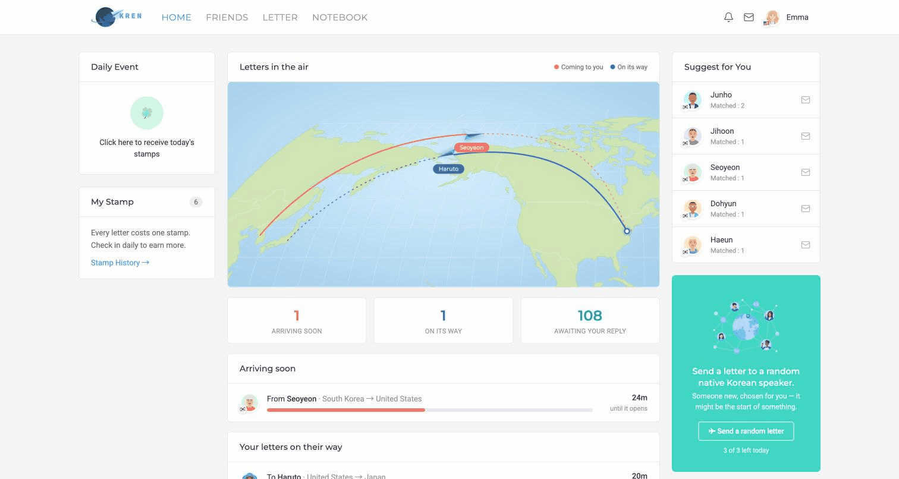
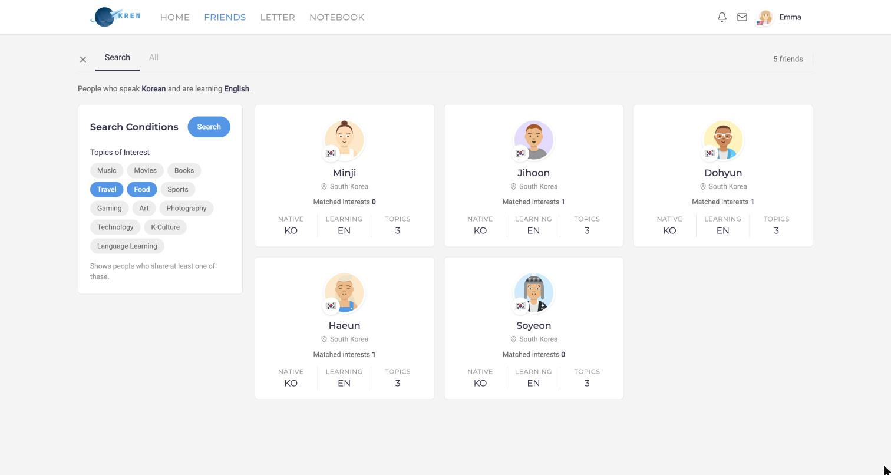
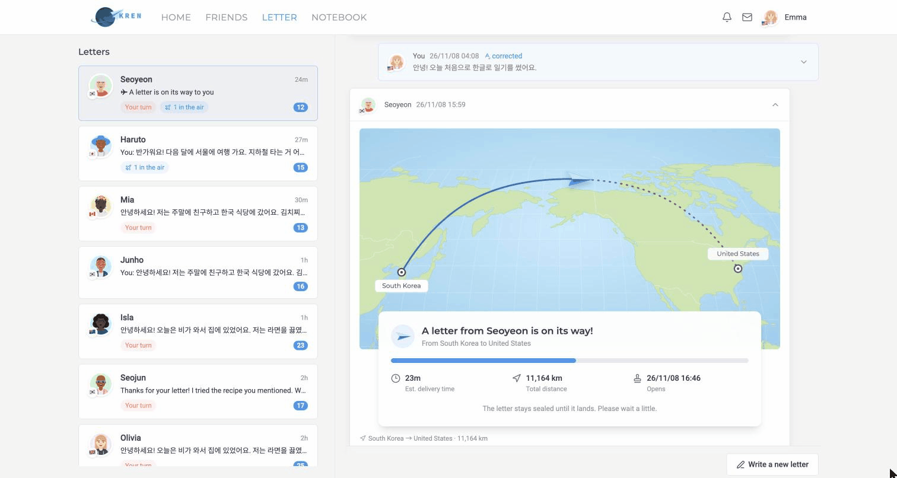
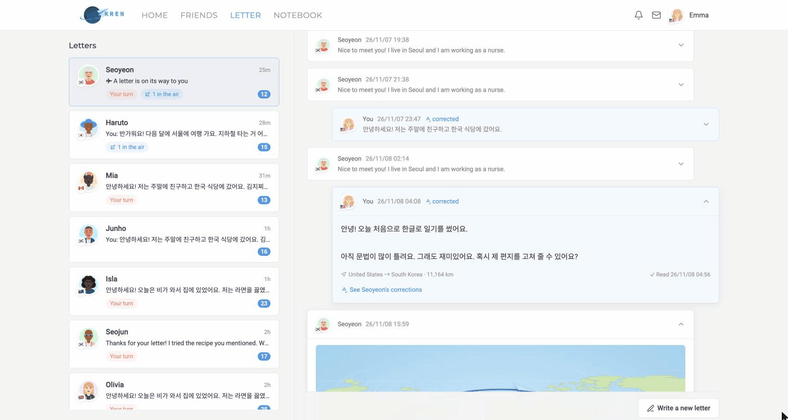
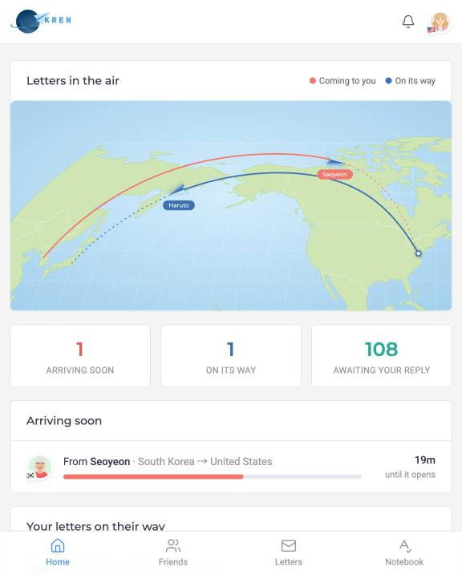
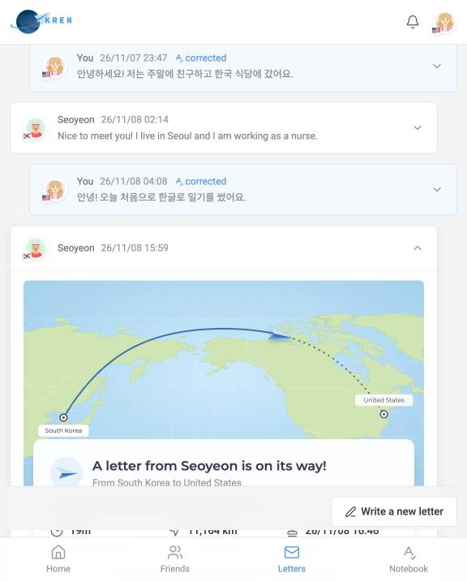
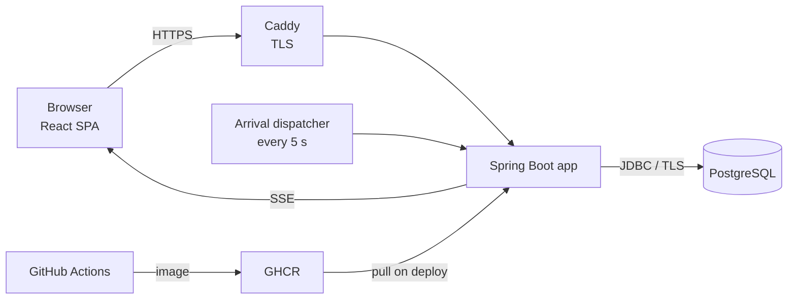
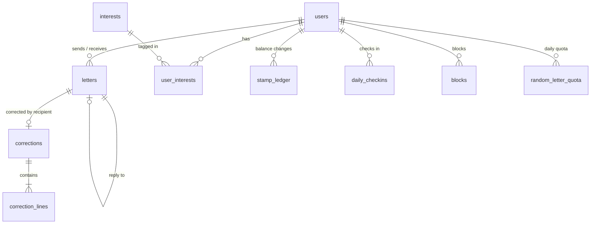

<p align="center">
     <h3 align="center">Penpal letters that travel like real mail, corrected by native speakers.</h3>
</p>


<p align="center">
  <a href="https://kren.jennachoi.me"><b>Live demo</b></a><br>
  No sign-up needed: press <b>TRY A DEMO</b> on the login screen to look around.
</p>
<p align="center">
  <a href="https://kren.jennachoi.me"></a>
</p>

<br>

## Table of contents

- [Background](#background)
- [Overview](#overview)
- [Features](#features)
- [Tech stack](#tech-stack)
- [How it works](#how-it-works)
- [Technical challenges](#technical-challenges)
- [Design decisions](#design-decisions)
- [What I learned](#what-i-learned)
- [Future improvements](#future-improvements)
- [Getting started](#getting-started)
- [Credits](#credits)
<br>

## Background

KREN started in 2021 as a six-person final project at a coding bootcamp, built with Java, Spring 5, JSP, MyBatis and Oracle. I helped with the initial backend design and worked on sign-up, profiles, account settings, multi-language support and UI integration.

KREN v2 is a solo rebuild from scratch in 2026. The original was a solid project, but server-rendered JSP with MyBatis and Oracle is far from what you would pick for a new service today. So I moved the same domain onto a current stack, cut the scope, and went deeper on the features I kept. No code was carried over; the original served only as a reference for the domain rules and the screen designs.

| | 2021 KREN | 2026 KREN v2 |
|---|---|---|
| Server | Spring 5, server-rendered JSP | Spring Boot 4.1 (Java 25) REST API |
| UI | JSP | React 19 + TypeScript SPA, served from the same origin |
| Data access | MyBatis | Spring Data JPA, with hand-written SQL where concurrency matters |
| Database | Oracle | PostgreSQL 18 with Flyway migrations |

On top of that, v2 adds real-time notifications with Server-Sent Events, integration tests with Testcontainers, CI/CD with GitHub Actions, a Docker image and a deployment on Azure.

Because I had worked on the original backend design, I already knew the domain rules. That freed me to spend the rebuild on backend correctness. Rules that must always hold are database constraints, and every race condition I found was first reproduced by a failing test, then fixed.
<br>

## Overview

Language-exchange apps tend to fall into two groups. Penpal sites connect people across countries but do little for learning, and chat apps offer corrections but encourage quick, shallow messages. KREN sits between them. I wanted people to feel what it is like to wait for a letter someone took their time to write.

You write to someone whose native language is the one you are learning, and who is learning yours. The letter flies across a map and takes time to arrive: two hours within a country, around 46 hours from Seoul to Washington, D.C. When it lands, the recipient can reply and correct your sentences one by one. Correcting someone's letter earns a stamp, and sending a letter costs one, so people who only receive letters eventually have to give something back. The corrections you receive collect in a notebook.

On the demo site, a background job has the demo accounts write, correct and answer each other every few minutes. It goes through the real service code, so there are always letters in the air and new corrections to look at. To keep the wait short, an hour of flight time passes in a minute on the demo.

The backend is Spring Boot 4 on Java 25 with PostgreSQL, and the frontend is a React and TypeScript single-page app served from the same origin. The interface is a rebuild of the 2021 KREN screens.
<br>

## Features

### Sign-up and profiles

A five-step sign-up collects account details, country, the language pair and interests, and a short introduction. Profiles show the language pair, interests (the ones you share with the viewer are highlighted), joining date and a stamp history, and each person picks an illustrated avatar.

### Home dashboard

The first screen after logging in gathers the letters in flight and everything waiting on you.

<p align="center"><br><sub>Letters crossing the map (time-lapse)</sub></p>

- The map in the middle shows every letter in the air as a paper plane. Letters coming to you are red, and letters you sent are blue.
- Below the map are counts of letters arriving soon, your letters on their way and letters waiting for your reply, followed by each flight's progress and time left and the list of letters to answer.
- On the left you check in daily for stamps and see your balance and stamp history.
- On the right are five suggested penpals, ordered by how many interests you share. Under them, the random-letter card sends a letter to someone new whose languages match, up to three new people a day.

### Finding penpals

The friends page lists people whose native language is the one you are learning and who are learning yours, filtered by shared interests and paginated. Anyone on either side of a block is left out.

<p align="center"><br><sub>Native Korean speakers learning English who are into travel or food</sub></p>

### Slow delivery with live tracking

Delivery time grows with distance: two hours of handling plus one hour per 250 km, capped at 72 hours. While a letter is in the air, the recipient sees the route, progress and time left, but not the letter itself.

<p align="center"><br><sub>A letter stays sealed until it lands, while the plane follows its route (time-lapse)</sub></p>

### Letters and corrections

The mailbox is a list of conversations, one per penpal. Opening one shows every letter between the two of you, oldest first, with earlier letters folded. Replying opens a two-column page: their letter to correct sentence by sentence on the left, your postcard on the right (tabs on phones).

Only changed sentences are saved, each with an optional note. The writer sees the original and corrected lines one above the other, with removed text in red and added text in blue. English is compared word by word and Korean character by character, so changing "famous for" to "popular with" doesn't turn into a jumble of letters. Every correction also goes into the writer's notebook.

<p align="center"><br><sub>Opening a correction shows what changed between BEFORE and AFTER</sub></p>

### Stamps, notifications and blocking

Stamps come from the sign-up bonus, a daily check-in and corrections, and every change is recorded in a ledger. The browser gets a notification right away when a letter takes off or lands and when a new correction comes in. Blocking hides two people from each other's search results and profiles and stops new letters; old letters stay in both mailboxes.

### Mobile

On phones the layout switches to a bottom tab bar and a compact header, and the postcard becomes a card that grows with its content.

<table align="center">
  <tr>
    <td align="center" width="50%"><br><sub>Home dashboard</sub></td>
    <td align="center" width="50%"><br><sub>A thread with one penpal</sub></td>
  </tr>
</table>

<br>

## Tech stack

| Layer | Technologies |
|---|---|
| Backend | Java 25, Spring Boot 4.1, Spring Security, Spring Data JPA (Hibernate 7), Bean Validation |
| Database | PostgreSQL 18, Flyway |
| Real-time | Server-Sent Events |
| Frontend | React 19, TypeScript, Vite, Tailwind CSS 4, TanStack Query, React Router |
| Maps | d3-geo, world-atlas (Natural Earth) |
| Testing | JUnit 5, Spring MockMvc, Testcontainers |
| Build and CI | Maven, npm, GitHub Actions |
| Deployment | Azure VM, Azure Database for PostgreSQL, Docker, GitHub Container Registry, Caddy |

<br>

## How it works

### Architecture



Instead of deploying the frontend separately, the Spring Boot server serves it too. With a single address, login can use a plain session cookie and I didn't have to deal with cross-origin requests (CORS). Caddy sits in front of the server and gets the HTTPS certificate automatically. Every push to main runs the tests on GitHub Actions, builds a Docker image and deploys it to the server.

The backend is split into packages by feature (`auth`, `user`, `letter`, `correction`, `stamp`, `block`, `notification`). Errors leave the API in the same JSON shape no matter where they happen, so the frontend handles them in one way.

### Database



Rules that must always hold live in the database as constraints: a stamp balance can't go negative, you check in once a day, you can't write to yourself, and a letter gets at most one correction. If the code has a bug, the database still says no. Schema changes only happen through Flyway migration files (V1 to V8).

### A letter's journey

1. Sending: taking a stamp, saving the letter and recording the stamp change happen in one transaction. If any of them fails, all three are rolled back.
2. In the air: the recipient is told a letter is on its way. Until it lands, the server doesn't send the body at all, so nobody can read it early by poking at the page.
3. Landing: every five seconds the server picks up letters whose arrival time has passed and notifies their recipients.
4. Correcting: when the recipient saves a correction, the stamp reward is paid in the same transaction and the writer gets a notification.

Code that depends on time reads an injected `Clock` instead of the system time, so tests can jump to one minute before a letter lands and then to the moment it does.

The mailbox groups letters by penpal, and the list is built with one query instead of one query per penpal. Loading older letters in a thread continues from the last letter you saw (keyset pagination), so new letters arriving in the meantime don't shift the page.

<br>

## Technical challenges

### When the same request arrives at the same time

Code that checks first and acts second breaks easily under parallel requests. If you check that a stamp is left and then take it, two requests can both see "one left" and both send a letter. I found four places like this. For each one I first wrote a test that fires parallel requests, then swapped in the naive code on purpose to make sure the test really catches the problem.

| Situation | Fix | With the naive code | After the fix |
|---|---|---|---|
| Ten letters sent at once with three stamps | A conditional `UPDATE` that only takes a stamp while the balance is at least 1 | 10 letters sent | exactly 3 |
| Several arrival jobs grabbing the same letters | `SELECT ... FOR UPDATE SKIP LOCKED`, so a job skips letters another one already took | 450 letters processed 1,250 times | exactly 450 |
| The same correction saved several times at once | A `UNIQUE(letter_id)` constraint on corrections | (the constraint decides) | 1 of 6 succeeds, one stamp paid |
| The three-a-day random letter limit hit in parallel | Checking and counting in a single `INSERT ... ON CONFLICT` statement | 6 letters sent | exactly 3 |

In all four cases the answer was to let the database make the decision in one step. Checks in the application code only stay to return an error early.

### Bugs worth remembering

- Tests passed or failed depending on the order they ran in. The cause was the `csrf()` helper from spring-security-test, which changed the CSRF setup for every test that came after it. The tests now send a real cookie and header like a browser does, which also checks the production configuration.
- All tests passed, but trying the app by hand, the first request after logging in got a 403. Spring Security issues a new CSRF token at login, and the new token reached the browser one request too late. The login response now carries it.
- A method marked `@Transactional` ran without a transaction. Calling a method on the same class skips Spring's proxy, so I switched to `TransactionTemplate`.
- Reading an entity after a stamp update threw a `LazyInitializationException`. The update query's `clearAutomatically = true` option had detached it from the persistence context. The response is now built before the update.
- Demo seeding once failed half-way and left a single account behind, and from then on every start saw that account and skipped seeding. It now runs in one transaction.
- With the database down, the login screen said "invalid email or password". Spring Security wraps a failed database lookup in an authentication exception, and my error handler treated every authentication exception as a wrong password. That case is now caught separately and returns a 500.

<br>

## Design decisions

- Login uses server sessions instead of JWTs. The frontend and API share an address, so a cookie just works, and logout and expiry are simpler.
- Tests run against a real PostgreSQL started by Testcontainers instead of an in-memory database like H2. Constraints and locking behave differently across databases, so I needed the real one to trust the tests.
- Opening the profile of someone on the other side of a block returns 404 instead of 403, because a 403 would reveal that the account exists. Opening someone else's letter is a 403.
- Notifications are sent only after the transaction commits. A cancelled send never notifies anyone, and a failed notification can't undo a send that already went through.
- Sending costs a stamp and correcting earns one, so two accounts trading letters and corrections can't farm stamps.
- Real-time connections (SSE) live in the server's memory, which only works with one server. Running several would need Redis or PostgreSQL `LISTEN/NOTIFY` to pass events between them.

<br>

## What I learned

Most of what I learned came from the bugs above. Test tools can quietly bypass the configuration you think you are testing, and a passing test suite says nothing about a flow nobody tested, so I now run the app by hand after touching anything related to login. Spring's proxies and Hibernate's persistence context felt abstract when I read about them, and I only understood them after each one broke something. With the concurrency fixes, I could only trust the tests after undoing each fix on purpose and watching them fail.

On the frontend, rebuilding my 2021 designs meant pulling colors, spacing and component patterns into design tokens, and drawing the delivery map meant learning map projections and how to compute the shortest route between two points on a globe.
<br>

## Future improvements

- Profile photo uploads with cropping, as in the original KREN
- Reporting and an admin view
- Redis or PostgreSQL `LISTEN/NOTIFY` so real-time notifications work across several servers
<br>

## Getting started

Requires JDK 25, Node 24 and Docker.

```bash
# backend (starts PostgreSQL from compose.yaml automatically)
cd backend
./mvnw spring-boot:run -Dspring-boot.run.arguments="--kren.demo.seed=true --kren.delivery.time-scale=60"

# frontend dev server with hot reload on :5173 (proxies /api to :8080)
cd frontend
npm install
npm run dev
```

`kren.demo.seed` creates 26 demo accounts (password `demo1234`) with letters already in flight, and `kren.delivery.time-scale=60` turns each hour of flight time into a minute.

```bash
cd backend && ./mvnw verify    # 112 tests against a throwaway PostgreSQL container
cd frontend && npm run build   # writes the SPA into the backend's static resources
docker build -t kren .         # production image
```

Deployment is described in [deploy/README.md](deploy/README.md).
<br>

## Credits

- Profile pictures: [Avataaars](https://avataaars.com/) by Pablo Stanley (free for personal and commercial use), rendered with [DiceBear](https://www.dicebear.com/).
- World map: [Natural Earth](https://www.naturalearthdata.com/) via [world-atlas](https://github.com/topojson/world-atlas).
- The visual design follows the original 2021 KREN screens, and some illustrations come from the UI kit that project used.
