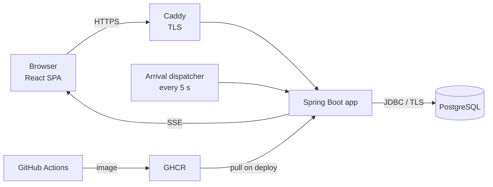
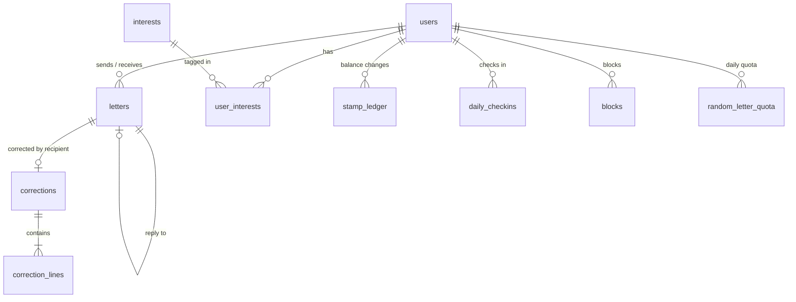

<h1 align="center">KREN</h1>

<h4 align="center">
  Slow letters, corrected by a friend.<br>
  A language-exchange penpal app where letters take hours to arrive and native speakers correct them.
</h4>

<p align="center">
  
</p>

<p align="center">
  Live demo: coming soon
  <!-- <a href="https://LIVE-URL">Live demo</a> · demo accounts: emma@demo.kren / minji@demo.kren, password demo1234 -->
</p>

<p align="center">
  <a href="https://github.com/jennachoi/KREN_V2/actions/workflows/ci.yml"></a>
</p>

<br>

## Table of contents

- [Background](#background)
- [Overview](#overview)
- [Features](#features)
- [Tech stack](#tech-stack)
- [How it works](#how-it-works)
- [Technical challenges](#technical-challenges)
- [Design decisions](#design-decisions)
- [What I learned](#what-i-learned)
- [Future improvements](#future-improvements)
- [Getting started](#getting-started)
- [Credits](#credits)

<br>

## Background

KREN started in 2021 as a six-person final project at a coding bootcamp, built with Java, Spring 5, JSP, MyBatis and Oracle. I worked on sign-up, profiles, account settings, multi-language support and UI integration.

KREN v2 is a solo rebuild from scratch in 2026. No code was carried over. The original served as a reference for the domain rules and the screen designs I had worked on, and the goal this time was backend depth: schema design, transactions and concurrency, authorization, testing, CI/CD and deployment.

<br>

## Overview

Language-exchange apps tend to fall into two groups. Penpal sites connect people across countries but do little for learning, and chat apps offer corrections but encourage quick, shallow messages. KREN sits between them.

You write to someone whose native language is the one you are learning, and who is learning yours. The letter flies across a live map and takes time to arrive: two hours within a country, around 46 hours from Seoul to Washington, D.C.. When it lands, the recipient can reply and correct your sentences one by one. Correcting someone's letter earns a stamp, and sending a letter costs one, so people who only receive letters eventually have to give something back. The corrections you receive collect in a notebook of things a native speaker would have written differently.

The backend is Spring Boot 4 on Java 25 with PostgreSQL, and the frontend is a React and TypeScript single-page app served from the same origin. The interface is a rebuild of the 2021 KREN screens.

<br>

## Features

### Sign-up and profiles

A five-step sign-up collects account details, country, the language pair and interests, and a short introduction. Profiles show the language pair, interests (the ones you share with the viewer are highlighted), joining date and a stamp history, and each person picks an illustrated avatar.

<!--
<table align="center">
  <tr>
    <td align="center" width="50%"><br><em>Five-step sign-up.</em></td>
    <td align="center" width="50%"><br><em>Profile with shared interests highlighted.</em></td>
  </tr>
</table>
-->

<br>

### Finding penpals

The friends page lists people whose native language is the one you are learning and who are learning yours, filtered by shared interests and paginated. Anyone on either side of a block is left out. A random-letter option sends to someone new whose languages match, up to three new people a day.

<!-- <p align="center"><br><em>Matching by language pair and interests.</em></p> -->

<br>

### Slow delivery with live tracking

Delivery time grows with distance: two hours of handling plus one hour per 250 km, capped at 72 hours. While a letter is in the air, the recipient sees a tracker with the route, progress and time left, but not the letter itself. The home dashboard shows every letter in flight on one map, alongside letters arriving soon and letters still waiting for a reply.

<!--
<table align="center">
  <tr>
    <td align="center" width="50%"><br><em>Letters in the air on the home dashboard.</em></td>
    <td align="center" width="50%"><br><em>A sealed letter on its way.</em></td>
  </tr>
</table>
<p align="center"><br><em>The plane follows the great-circle route in real time.</em></p>
-->

<br>

### Letters and corrections

Letters are written on a postcard. After a letter arrives, the recipient can reply or open the correction editor, which puts each sentence next to an editable copy. Only changed sentences are saved, each with an optional note, and the writer sees them as an inline diff. Every correction also goes into the writer's notebook.

<!--
<table align="center">
  <tr>
    <td align="center" width="50%"><br><em>Writing on a postcard.</em></td>
    <td align="center" width="50%"><br><em>A correction shown as an inline diff.</em></td>
  </tr>
</table>
-->

<br>

### Stamps, notifications and blocking

Stamps come from the sign-up bonus, a daily check-in and corrections, and every change is recorded in a ledger. Takeoff, arrival and new corrections are pushed to the browser with Server-Sent Events. Blocking hides two people from each other's search results and profiles and stops new letters; old letters stay in both mailboxes.

<br>

## Tech stack

| Layer | Technologies |
|---|---|
| Backend | Java 25, Spring Boot 4.1, Spring Security, Spring Data JPA (Hibernate 7), Bean Validation |
| Database | PostgreSQL 18, Flyway migrations |
| Realtime | Server-Sent Events, transactional application events |
| Frontend | React 19, TypeScript, Vite, Tailwind CSS 4, TanStack Query, React Router |
| Maps | d3-geo, world-atlas (Natural Earth) |
| Testing | JUnit 5, Spring MockMvc, Testcontainers (real PostgreSQL) |
| Build and CI | Maven, npm, GitHub Actions |
| Deployment | Docker (multi-stage image), GitHub Container Registry, Docker Compose, Caddy (automatic HTTPS) |

<br>

## How it works

### Architecture



The React build is bundled into the Spring Boot jar and served from the same origin as the API. That keeps authentication simple: a session cookie and a double-submit CSRF cookie, with no CORS configuration. Client-side routes fall back to `index.html`, while unknown `/api` paths still return JSON errors.

The backend is organized by domain (`auth`, `user`, `letter`, `correction`, `stamp`, `block`, `notification`), each with its own controller, service, repository and DTOs. Every error leaves the API as an RFC 9457 problem detail with a machine-readable `code`, including 401s and 403s raised inside the security filter chain.

### Data model



Rules that must always hold live in the database: a stamp balance can't go negative, a check-in is unique per user and day, nobody writes to themselves, a letter gets at most one correction, and a corrected sentence must differ from the original. Flyway owns the schema (V1 to V6), and Hibernate only validates it.

### A letter's life

1. Sending runs in one transaction: deduct a stamp, insert the letter with its origin, destination, distance and `deliver_at`, and write a ledger row.
2. After the commit, the recipient gets an `incoming` event. Until `deliver_at`, the API returns the route and arrival time to the recipient but withholds the body and preview, and replies and corrections are refused.
3. A dispatcher wakes every five seconds, claims letters that have landed and pushes a `letter` event to each recipient.
4. The recipient corrects the letter. Saving the correction and paying the stamp reward share one transaction, and the writer gets a `correction` event.

All time-dependent logic reads an injected `Clock`, so tests can move time forward to the minute before a letter lands and then to the minute it does.

<br>

## Technical challenges

### Four concurrency problems, each proven with a failing test

For each one I wrote a test that fires parallel requests, then swapped in the obvious check-then-act implementation to confirm the test catches it.

| Problem | Solution | Naive version | Actual result |
|---|---|---|---|
| Ten parallel sends with three stamps | Conditional `UPDATE ... SET balance = balance - 1 WHERE balance >= 1` inside the send transaction | 10 letters sent | exactly 3 |
| Several dispatchers landing the same letters | `SELECT ... FOR UPDATE SKIP LOCKED`, so each worker claims a disjoint batch | 450 letters processed 1,250 times | exactly 450 |
| Double-submitting a correction | `UNIQUE(letter_id)` on corrections, with the reward in the same transaction | (the constraint decides) | 1 of 6 succeeds, one stamp paid |
| Random letters limited to three a day | One `INSERT ... ON CONFLICT DO UPDATE SET used = used + 1 WHERE used < 3` | 6 letters sent | exactly 3 |

The pattern is the same in all four: the database makes the decision atomically, and any check in application code only exists to fail fast.

### Bugs worth remembering

- The `csrf()` helper in spring-security-test replaces the shared CSRF repository for every later test, so cookie-based tests passed or failed depending on order. The tests now send a real cookie and header, which also exercises the production configuration.
- Every automated test passed, but a manual run showed that a POST right after login got a 403. Spring Security rotates the CSRF token on login, and the new cookie wasn't written until the next request. The login response now carries it.
- A batch method called another `@Transactional` method on the same class. Self-invocation bypasses Spring's proxy, so no transaction was opened. The batch now uses `TransactionTemplate`.
- A stamp update with `clearAutomatically = true` detached an entity that was used afterwards, causing a `LazyInitializationException`. The response is now built before the update.
- The demo seeder failed half-way once and left one account behind, and every later start saw that account and skipped seeding. It now runs in one transaction, and because it mixes JDBC with JPA, it flushes and clears the persistence context around the raw SQL.

<br>

## Design decisions

- Sessions instead of JWTs, because the SPA and API share an origin and server-side sessions make logout and expiry straightforward.
- Integration tests run against PostgreSQL in Testcontainers instead of H2, so constraints, locking and Postgres-specific SQL are tested for real.
- Blocked users get a 404 instead of a 403, so a block doesn't reveal that the account exists. Someone else's letter is a 403.
- Notifications are transactional events delivered after commit, so a rolled-back send never notifies anyone, and a failed push can't fail a send that already committed.
- Sending costs one stamp and correcting earns one, so two accounts trading letters and corrections gain nothing.
- Avatars and country and language codes come from fixed allow-lists validated on the server.
- SSE connections live in memory, which works for one instance. Running several would need Redis pub/sub or Postgres `LISTEN/NOTIFY` to fan events out.

<br>

## What I learned

Most of what I took away came from the bugs above. Test tooling can quietly bypass the configuration you think you are testing, and a passing suite says nothing about a flow nobody wrote a test for, so I now run the app by hand after anything touching authentication. Spring's proxies and Hibernate's persistence context stopped being abstractions once each of them broke something. Breaking each concurrency fix on purpose was the only way to know the tests measured anything.

On the frontend side, rebuilding my own 2021 designs meant extracting colors, spacing and component patterns into design tokens instead of copying a template, and drawing the delivery map meant learning map projections and great-circle interpolation.

<br>

## Future improvements

- Profile photo uploads with cropping, as in the original KREN
- A background job on the demo site that keeps letters flying between demo accounts
- Reporting and an admin view
- Redis or Postgres `LISTEN/NOTIFY` for SSE across several instances

<br>

## Getting started

Requires JDK 25, Node 24 and Docker.

```bash
# backend (starts PostgreSQL from compose.yaml automatically)
cd backend
./mvnw spring-boot:run -Dspring-boot.run.arguments="--kren.demo.seed=true --kren.delivery.time-scale=60"

# frontend dev server with hot reload on :5173 (proxies /api to :8080)
cd frontend
npm install
npm run dev
```

`kren.demo.seed` creates 26 demo accounts (password `demo1234`) with letters already in flight, and `kren.delivery.time-scale=60` turns each hour of flight time into a minute.

```bash
cd backend && ./mvnw verify    # 99 tests against a throwaway PostgreSQL container
cd frontend && npm run build   # writes the SPA into the backend's static resources
docker build -t kren .         # production image
```

Deployment is described in [deploy/README.md](deploy/README.md).

<br>

## Credits

- Profile pictures: [Avataaars](https://avataaars.com/) by Pablo Stanley (free for personal and commercial use), rendered with [DiceBear](https://www.dicebear.com/).
- World map: [Natural Earth](https://www.naturalearthdata.com/) via [world-atlas](https://github.com/topojson/world-atlas).
- The visual design follows the original 2021 KREN screens, and some illustrations come from the UI kit that project used.
